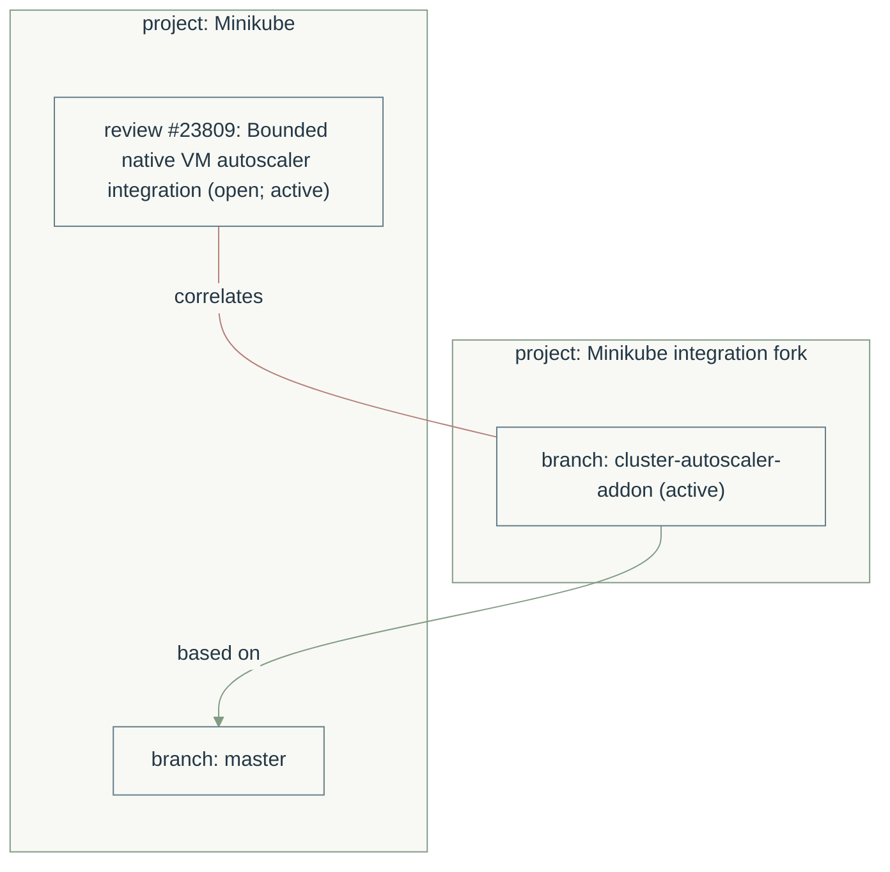

<!-- witful-work-graph:begin -->

Containment shows ownership; arrows name recorded relationships.

Associated work:

- [branch: cluster\-autoscaler\-addon](<https://github.com/astrivant/minikube/tree/cluster-autoscaler-addon>)
- [project: Minikube integration fork](<https://github.com/astrivant/minikube>)
- [branch: master](<https://github.com/kubernetes/minikube/tree/master>)
- [project: Minikube](<https://github.com/kubernetes/minikube>)
- [review \#23809: Bounded native VM autoscaler integration](<https://github.com/kubernetes/minikube/pull/23809>)

<!-- witful-work-graph:end -->
